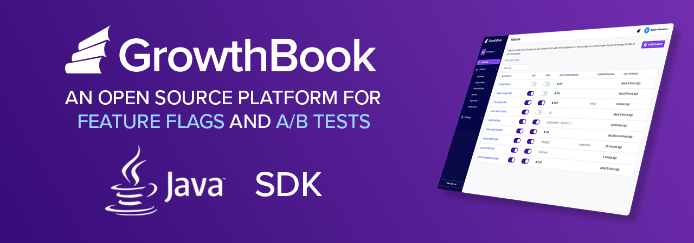

[](https://jitpack.io/#growthbook/growthbook-sdk-java)

# GrowthBook Java SDK

- [Requirements](#requirements)
- [Documentation](#documentation)
- [Installation](#installation)
- [Async evaluation](#async-evaluation)
- [Caching & Refresh Strategy](#caching--refresh-strategy)
- [Remote Evaluation](#remote-evaluation)
- [Sticky Bucketing](#sticky-bucketing)
- [Contributing](#contributing)
  - [Releasing a new version](#releasing-a-new-version)

## Requirements

- Java version 1.8 or later

## Documentation

- [Usage Guide](https://docs.growthbook.io/lib/java)
- [JavaDoc class documentation](https://growthbook.github.io/growthbook-sdk-java/)

## Installation

The SDK is published on [JitPack](https://jitpack.io/#growthbook/growthbook-sdk-java).

### Gradle

```groovy
repositories {
    maven { url 'https://jitpack.io' }
}

dependencies {
    implementation 'com.github.growthbook.growthbook-sdk-java:lib:0.13.0'
}
```

### Maven

```xml
<repositories>
    <repository>
        <id>jitpack.io</id>
        <url>https://jitpack.io</url>
    </repository>
</repositories>

<dependency>
    <groupId>com.github.growthbook.growthbook-sdk-java</groupId>
    <artifactId>lib</artifactId>
    <version>0.13.0</version>
</dependency>
```

### Optional modules

Same group and version as `lib`.

| Artifact | Adds |
| --- | --- |
| `growthbook-cache-caffeine` | A Caffeine-backed feature cache |
| `growthbook-cache-jcache` | A JSR-107 (JCache) feature cache |
| `growthbook-cache-redis` | A Redis feature cache and Redis sticky bucket services, for Jedis and Lettuce |

`com.github.growthbook:growthbook-sdk-java:0.13.0` also resolves. It is an aggregate that pulls in `lib` and all three optional modules.

> We are proposing two way of initializing SDK:

### GrowthBookClient

`GrowthBookClient` lets you share the same instance for all requests with an ability to accept the user attributes
while calling the feature methods like `isOn()`. This `GrowthBookClient` instance is decoupled from the `GBContext`,
owns a feature repository based on your refresh strategy and uses the latest features at the time of evaluation,
all managed internally.

```java

// build options to configure your Growthbook instance
Options options = Options.builder()
        .apiHost("https://cdn.growthbook.io")
        .clientKey("sdk-abc123")
        .build();

// Create growthbook instance using the options you need
GrowthBookClient gb = new GrowthBookClient(options);

// Optional metadata-only listener for successful and failed feature refreshes
FeatureRefreshSubscription refreshSubscription = gb.subscribeFeatureRefreshListener(event -> {
    if (event.isSuccessful()) {
        System.out.println("Refresh source: " + event.getSource());
        System.out.println("Features changed: " + event.isFeaturesChanged());
        System.out.println("Loaded from cache: " + event.isLoadedFromCache());
        System.out.println("Refresh duration: " + event.getDurationMillis() + " ms");
        System.out.println("Active features: " + event.getActiveFeatureCount());
    } else {
        System.out.println("Feature refresh failed: " + event.getError());
    }
});

// call the init method to load features 
gb.initialize();

gb.isOn("featureKey", UserContext.builder()
    .attributesJson("{\"id\" : \"123\"}").build()
);

// Stop receiving refresh events when no longer needed
refreshSubscription.close();
```

Feature refresh listeners are dispatched off the refresh thread on a dedicated daemon thread owned by
the client. Supply your own executor with
`Options.builder().featureRefreshListenerExecutor(executor).build()` to control the threading yourself.

### Manually create separate instance of GBContext, Repository and Growthbook classes

```java
GBFeaturesRepository featuresRepository = GBFeaturesRepository
    .builder()
    .apiHost("https://cdn.growthbook.io")
    .clientKey("<environment_key>") // replace with your client key
    .encryptionKey("<client-key-for-decrypting>") // optional, nullable
    .refreshStrategy(FeatureRefreshStrategy.SERVER_SENT_EVENTS) // optional; options: STALE_WHILE_REVALIDATE, SERVER_SENT_EVENTS (default: STALE_WHILE_REVALIDATE)
    .build();

// Optional listener for getting metadata when features are refreshed
FeatureRefreshListener refreshListener = event -> {
    if (event.isSuccessful()) {
        System.out.println("Features have been refreshed");
        System.out.println("Features changed: " + event.isFeaturesChanged());
    } else {
        System.out.println("Features refreshed with error");
        System.out.println(event.getError());
    }
};
featuresRepository.addFeatureRefreshListener(refreshListener);

try {
    featuresRepository.initialize();
} catch (FeatureFetchException e) {
    // TODO: handle the exception
    e.printStackTrace();
}

// Initialize the GrowthBook SDK with the GBContext, features and saved groups
GBContext context = GBContext
    .builder()
    .featureSnapshot(featuresRepository.getFeatureSnapshot())
    .attributesJson(userAttributesJson)
    .build();

GrowthBook growthBook = new GrowthBook(context);

growthBook.isOn("featureKey");
```

> **Threading note.** Listeners registered directly on a repository
> (`featuresRepository.addFeatureRefreshListener(...)`) run **synchronously on the refresh thread** —
> the polling scheduler, the SSE event thread, or the caller of a manual refresh. A slow listener
> delays the next refresh, and a blocking one stalls feature updates. Keep the callback short or
> hand the event off to your own executor.
>
> This does not apply to `GrowthBookClient.addFeatureRefreshListener(...)` /
> `subscribeFeatureRefreshListener(...)`: the client dispatches those off the refresh thread, on a
> dedicated daemon thread or on the executor you pass via `Options.featureRefreshListenerExecutor`.

`GBContext` needs both the features and the saved groups from the payload. Without the saved
groups, rules that reference them by ID match nobody (or, for exclusions, everybody).

| Source | Builder call |
| --- | --- |
| `GBFeaturesRepository` | `.featureSnapshot(repo.getFeatureSnapshot())` |
| `NativeJavaGbFeatureRepository` | `.featuresJson(repo.getFeaturesJson()).savedGroupsJson(repo.getSavedGroupsJson())` |
| Your own fetch | `.featuresJson(...)` and `.savedGroupsJson(...)` from the response's `features` and `savedGroups` |

`GrowthBookClient` handles this itself. After a refresh, build a new `GBContext` from the repository.

## Async evaluation

Available starting in 0.13.0. Each evaluation method on `GrowthBookClient` has an `...Async` twin that
returns a `CompletableFuture`: `isOnAsync`, `isOffAsync`, `evalFeatureAsync`, `getFeatureAsync`,
`getFeatureValueAsync`, `runAsync`, and `initializeAsync`. Use them when evaluation waits on a
[sticky bucket](#sticky-bucketing) store and you do not want to hold the request thread.

```java
GrowthBookClient gb = new GrowthBookClient(Options.builder()
        .apiHost("https://cdn.growthbook.io")
        .clientKey("sdk-abc123")
        .asyncStickyBucketService(stickyBucketService)
        .build());
gb.initializeAsync();

UserContext user = UserContext.builder().attributesJson("{\"id\":\"user_123\"}").build();

gb.getFeatureValueAsync("button-color", "blue", String.class, user)
        .thenAccept(color -> render(color));
```

- Nothing is thrown on the calling thread. Failures arrive through the future.
- A sticky bucket read that fails or times out does not fail the future. The user is bucketed by hash
  and nothing is saved.
- After `shutdown()`, async methods do not evaluate: the future fails with `IllegalStateException`.
  `getFeatureValueAsync` completes with the default value and `initializeAsync` with `false`.
- Only an `AsyncStickyBucketService` keeps the wait free of threads. A blocking `StickyBucketService`,
  `initializeAsync()`, and remote evaluation each hold a thread of the client's executor
  (`Options.asyncExecutor`) while they wait.

Full reference: [Async evaluation](https://docs.growthbook.io/lib/java#async-evaluation).

## Caching & Refresh Strategy

### Cache modes

The SDK supports multiple cache modes for persisting feature payloads:

- FILE: persist to a writable directory (configurable). Defaults to a safe OS-specific cache dir (or `java.io.tmpdir`).
- MEMORY: in-process cache only (no filesystem writes).
- NONE: no cache I/O. Runtime still holds the latest fetched features.
- CUSTOM: supply your own `GbCacheManager` implementation.

You can configure these through `Options` when using `GrowthBookClient`, or via the repository builder’s `cacheManager` directly. When cache is disabled (`isCacheDisabled=true`), the repository won’t attempt any persistence.

### Caffeine cache adapter

The optional `growthbook-cache-caffeine` module provides a Caffeine-backed `GbCacheManager` for applications that want a production-ready in-process cache without using filesystem persistence.

```groovy
dependencies {
    implementation 'com.github.growthbook.growthbook-sdk-java:lib:0.13.0'
    implementation 'com.github.growthbook.growthbook-sdk-java:growthbook-cache-caffeine:0.13.0'
}
```

```java
import growthbook.sdk.java.cache.caffeine.CaffeineGbCacheManager;
import growthbook.sdk.java.multiusermode.GrowthBookClient;
import growthbook.sdk.java.multiusermode.configurations.Options;
import growthbook.sdk.java.sandbox.CacheMode;

import java.time.Duration;

Options options = Options.builder()
        .apiHost("https://cdn.growthbook.io")
        .clientKey("sdk-abc123")
        .cacheMode(CacheMode.CUSTOM)
        .cacheManager(CaffeineGbCacheManager.builder()
                .maximumSize(1000)
                .expireAfterWrite(Duration.ofMinutes(30))
                .buildManager())
        .build();

GrowthBookClient gb = new GrowthBookClient(options);
```

### STALE_WHILE_REVALIDATE (default)

With the SWR strategy, the repository will:

- Perform an initial synchronous fetch during `initialize()`.
- Start a lightweight background poller that revalidates features on a fixed delay (by default equal to the TTL). The poller is protected against overlapping runs and logs start/end of each polling cycle.
- Keep the latest features in memory and publish `FeatureRefreshListener` events when updated so the `GlobalContext` stays fresh.

For SSE connections, the repository establishes a server‑sent events stream and updates as changes arrive; the SWR poller is not used.


- The `evalFeature()` method evaluates a feature based on the provided parameters.
It takes three arguments: a string representing the unique identifier of the feature,
a generic class valueTypeClass that specifies the type of the result value (e.g., Integer, String, Boolean),
an UserContext object, which contains attributes, forceVariations and forceFeatureValues to provide a more flexible way of evaluating features.
The method returns a FeatureResult object, which contains the evaluated result of the feature along with any additional metadata.

```java
public <ValueType> FeatureResult<ValueType> evalFeature(String key, Class<ValueType> valueTypeClass, UserContext userContext);
```

- `getFeatureValue()` the same purpose as in `evalFeature()`, but have ability to provide default value

```java
public <ValueType> ValueType getFeatureValue(String featureKey, ValueType defaultValue, Class<ValueType> gsonDeserializableClass, UserContext userContext);
```

- The `isOn()` / `isOff()` method takes a string argument, which is the unique identifier for the feature, and UserContext, which contains attributes, forceVariations and forceFeatureValues to provide a more flexible way of evaluating features. Functions return the feature state on/off

```java
public Boolean isOn(String featureKey, UserContext userContext);

public Boolean isOff(String featureKey, UserContext userContext);
```

- The `run()` method takes an Experiment object and UserContext. Function returns an ExperimentResult

```java
public <ValueType> ExperimentResult<ValueType> run(Experiment<ValueType> experiment, UserContext userContext);
```

- If you changed, added or removed any features, trigger a feature refresh. A forced refresh always performs a
  network request in the background and bypasses cache freshness checks, while current features remain available
  for evaluation. For remote evaluation payloads, use `refreshForRemoteEval(...)`.

```java
growthBook.refreshFeatures(RefreshMode.FORCE);

growthBook.refreshForRemoteEval(requestBodyForRemoteEval);
```

- You can optionally configure a minimum interval between non-forced background refreshes and customize the bounded
  exponential retry policy. Both options are disabled/defaulted when omitted.

```java
Options options = Options.builder()
    .apiHost("https://cdn.growthbook.io")
    .clientKey("sdk-abc123")
    .backgroundFetchInterval(Duration.ofHours(48))
    .retryPolicy(new FeatureFetchRetryPolicy(
        5,
        Duration.ofSeconds(1),
        Duration.ofSeconds(16)
    ))
    .build();
```

## Remote Evaluation

This mode brings the security benefits of a backend SDK to the front end by evaluating feature flags exclusively on a
private server. Using Remote Evaluation ensures that any sensitive information within targeting rules or unused feature
variations are never seen by the client. Note that Remote Evaluation should not be used in a backend context.

You must enable Remote Evaluation in your SDK Connection settings. Cloud customers are also required to self-host a
GrowthBook Proxy Server or custom remote evaluation backend.

To use Remote Evaluation, set the `FeatureRefreshStrategy = REMOTE_EVAL_STRATEGY` property to your Repository or Options instance. A new evaluation API call will be
made any time a user attribute or other dependency changes.

> If you would like to implement Sticky Bucketing while using Remote Evaluation, you must configure your remote evaluation
> backend to support Sticky Bucketing. You will not need to provide a StickyBucketService instance to the client side SDK.

## Sticky Bucketing

Sticky Bucketing persists each user's experiment assignments, so a user keeps their variation when
attributes, login state, or targeting change mid-experiment. See the
[Sticky Bucketing docs](https://docs.growthbook.io/app/sticky-bucketing) for the concept.

Give the SDK a service that stores the assignments:

| Service | Option | Synchronous methods | Async methods |
| --- | --- | --- | --- |
| `InMemoryStickyBucketServiceImpl` | `stickyBucketService` | In memory, one JVM only | Same |
| A blocking `StickyBucketService` (Jedis, blocking Lettuce, JDBC) | `stickyBucketService` | Reads and saves run on the calling thread | Reads and saves run on the client's executor |
| An `AsyncStickyBucketService` (async Lettuce) | `asyncStickyBucketService` | The calling thread waits for the read | No thread is held |

Set one of the two options, not both.

```java
// One instance: in memory
Options options = Options.builder()
        .apiHost("https://cdn.growthbook.io")
        .clientKey("sdk-abc123")
        .stickyBucketService(new InMemoryStickyBucketServiceImpl(new HashMap<>()))
        .build();
```

```java
// Many instances: Redis, without blocking a thread (needs growthbook-cache-redis and Lettuce)
StatefulRedisConnection<String, String> connection =
        RedisClient.create("redis://localhost:6379").connect();

GrowthBookClient gb = new GrowthBookClient(Options.builder()
        .apiHost("https://cdn.growthbook.io")
        .clientKey("sdk-abc123")
        .asyncStickyBucketService(new LettuceAsyncStickyBucketService(connection))
        .build());

gb.isOnAsync("new-homepage", user).thenAccept(enabled -> render(enabled));
```

`JedisStickyBucketService` and `LettuceStickyBucketService` are the blocking Redis services. All three
take an optional key prefix and expiry, write `<keyPrefix><attributeName>||<attributeValue>` keys in
the format the JavaScript SDK's `RedisStickyBucketService` uses, and merge on save.

What to know before you ship:

- **Attributes read.** `GrowthBookClient` reads a document for each attribute your experiments hash
  on, plus `Options.stickyBucketIdentifierAttributes`. Before 0.13.0 it read every user attribute.
- **Prefetching with inline experiments.** A context from `prefetchStickyBuckets` has documents only
  for those attributes. An inline experiment passed to `run()` that hashes on another one reads its
  document when it runs. List that attribute in `stickyBucketIdentifierAttributes` so the prefetch
  covers it. In 0.13.0 that read was skipped and the stored assignment was replaced; later versions
  fix this.
- **Store failures.** A read that fails, or takes longer than `Options.stickyBucketTimeout` (5 seconds
  by default), does not fail the evaluation. The user is bucketed by hash and nothing is saved, so
  the stored assignment is never replaced.
- **Saves.** With an async service, and on the async methods, saves happen in the background.
  `shutdown()` flushes them; `flushStickyBucketSaves()` does it on demand.
- **Remote evaluation.** Do not configure a sticky bucket service with `remoteEval`; the client
  rejects that combination.

Full reference, including custom services and every option:
[Sticky Bucketing](https://docs.growthbook.io/lib/java#sticky-bucketing).

## Contributing

### Releasing a new version

We use [Release-Please](https://github.com/googleapis/release-please) to automate our release process. The release process follows these steps:

1. **Make changes using Conventional Commits**: When making changes, format your commit messages following the [Conventional Commits](https://www.conventionalcommits.org/) spec:
   - `fix: message` - for bug fixes (triggers a patch version bump)
   - `feat: message` - for new features (triggers a minor version bump)
   - `feat!: message` or `fix!: message` - for breaking changes (triggers a major version bump)
   - `docs: message` - for documentation changes (no version bump)
   - `chore: message` - for maintenance changes (no version bump)

2. **Automated Release PR**: When commits are pushed to the `main` branch, Release-Please will automatically create or update a release PR that:
   - Updates the version in `gradle.properties` and `Version.java`
   - Updates the `CHANGELOG.md` with all the changes since the last release
   - Groups changes by type (features, fixes, etc.)

3. **Review and Merge**: Review the Release PR and merge it when ready to trigger a release.

4. **Automated Release**: Upon merging the Release PR, the action will:
   - Create a Git tag for the new version
   - Create a GitHub Release with release notes
   - Upload build artifacts to the GitHub Release

5. **Jitpack Integration**: Jitpack will automatically detect the new release tag and make it available for download.

No manual version updates are required!
